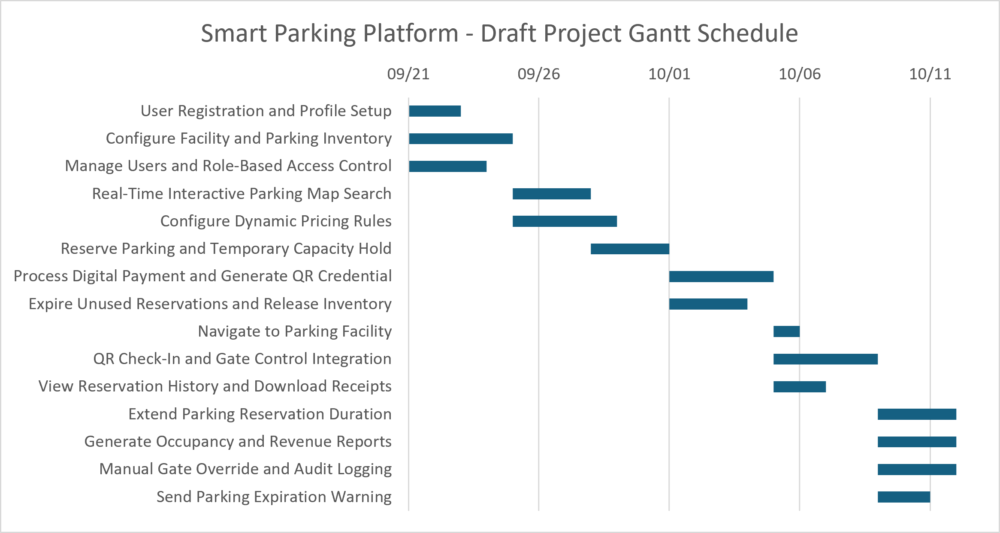
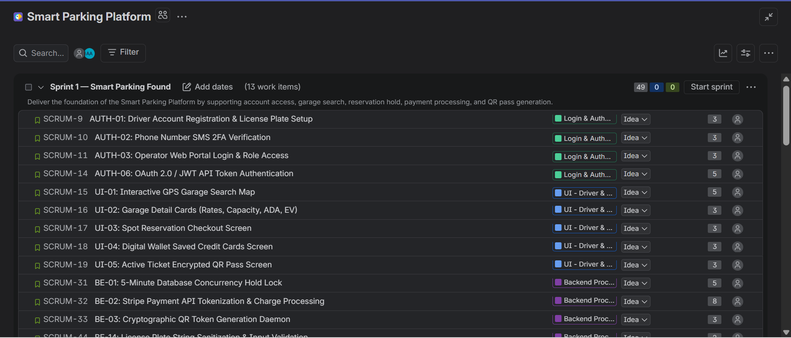
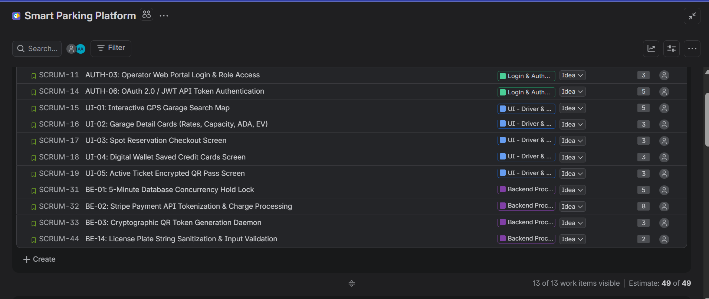
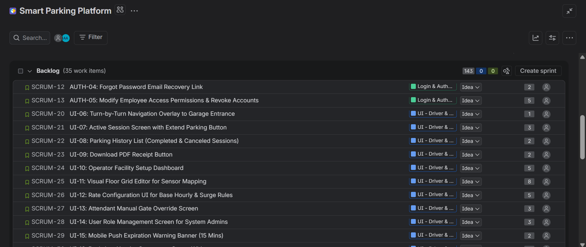
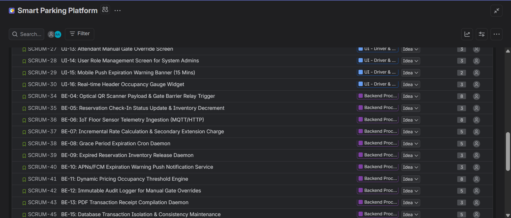
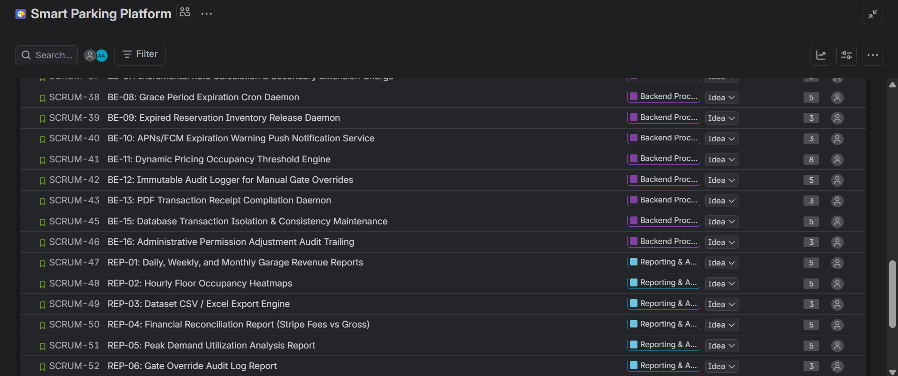
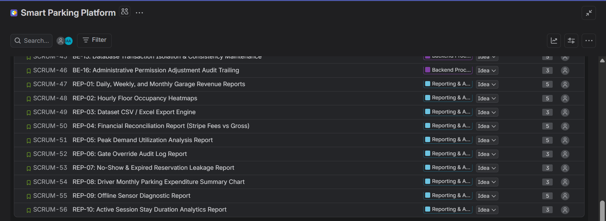

# Software Requirements Specification (SRS)

Project: Smart Parking Platform

Version: **1.8 Baseline (v1.8)**

Date: 11.19.2026


## 1. Introduction

### 1.1 Purpose

This document defines the requirements for the $oftware ¢orp. Smart Parking Platform. It describes the system's users, functional behavior, quality expectations, business rules, and use cases that will later assist us in our estimations, scheduling, design, and implementation.

### 1.2 Scope

The Smart Parking Platform is a double sided parking management solution. The drivers use a mobile application to locate the participating parking facilities, view the availability and rates, reserve parking, make digital payments, receive direction to the facility, gain entry, manage sessions, and view receipts. Parking operators and administrators use a web portal to configure facilities, map the inventory, manage pricing, review reports, and override and manage access. The background processes include removing unused reservations and sending expiration alerts.

### Explicitly Out of Scope

- Physical manufacturing, installation, or hardware maintenance of parking barrier gates, optical scanners, and IoT floor sensors
- Municipal traffic citation enforcement, parking ticket violation processing, and legal collections
- On-site valet or physical attendant staffing operations

### 1.3 Brief Project Acquisition

I would start with a garage operator or campus parking service and find out how they currently manage reservations, payments, and entry. Before presenting the project, I would check whether their equipment can connect to the platform and whether an existing service already meets their needs. This would help explain why a custom solution is worth considering.

Alice would prepare the scope, 12-week schedule, and $69,888 funding proposal. The sponsor and garage owner would review the deliverables and acceptance requirements before signing an agreement. This is how I would approach a potential client. There is no confirmed agreement yet.

## 2. Overall Description

Users: The finished Smart Parking Platform will have several different types of users. Including drivers, parking facility operators and system administrators.

System Environment: The Smart Parking Platform will use both a mobile and web-based environment.

Constraints: The system depends on several outside technologies. Users have to authenticate before they reach protected features, drivers need a supported mobile device, and location based features only work when GPS permissions are granted. Payments run on Stripe. Facilities that want real-time occupancy have to connect compatible sensors to the platform, and QR entry needs compatible scanners and gate hardware. The system also protects sensitive user, payment, and administrative data, and limits administrative features by role.

Assumptions: The Smart Parking Platform assumes that users have reliable internet access while using the application. It also assumes that parking facilities have internet-connected equipment that can communicate with the platform. Drivers are expected to provide account and vehicle information and allow location access when using location-based features. The system assumes that external services such as payment, mapping, messaging, and garage hardware systems are available when their features are needed. It is also assumed that parking operators will keep facility information, pricing rules, operating hours, and parking inventory configurations up to date.

### Evaluation of existing software solutions

The providers' websites show several features that overlap with this project. What a garage can use depends on its equipment and the services it supports.

- **ParkMobile / PayByPhone:** These services overlap with our payment and parking-session features. ParkMobile lists integrations for parking availability, gated payments, and access control. PayByPhone lets drivers pay for parking and extend eligible sessions. I would compare the integrations available at the proposed garage before recommending a custom platform. [ParkMobile integrations](https://www.parkmobile.io/parking-providers/integrations); [PayByPhone features](https://www.paybyphone.com/drivers/how-it-works).
- **SpotHero / ParkWhiz:** Both provide prepaid parking reservations. SpotHero describes entry by QR code, attendant validation, or license plate. ParkWhiz also supports several validation methods, including scanning a QR code at a gate. These services already cover parts of the reservation-to-entry process, so gate integration alone is not a unique feature of our project. [SpotHero FAQ](https://spothero.com/faq); [ParkWhiz pass validation](https://help.parkwhiz.com/support/solutions/articles/60001010475-how-do-i-prove-i-ve-already-paid-for-parking-).
- **Passport:** Passport offers mobile payments and connections to gated parking, permitting, and enforcement. It competes with our payment and operator functions, although enforcement remains outside our scope. [Passport mobile payments](https://www.passportinc.com/mobile-payments-product-details/).
- **Our Smart Parking Platform:** Our proposed value is connecting reservations, payments, sensor telemetry, garage entry, and operator reporting for a participating facility. I would also focus on what happens when a payment is uncertain, sensor information is outdated, or a gate does not open. We would need operator feedback and testing before claiming that our platform performs better than an existing service.

## 3. Functional Requirements

- FR1: The system shall allow drivers to create an account and save their basic vehicle information.
- FR2: The system shall verify new driver account by sending a verification code through SMS.
- FR3: The system shall allow drivers to use their current location to search for nearby parking facilities.
- FR4: The system shall show drivers current parking availability, parking rates, operating hours, and available parking types for each facility.
- FR5: The system shall allow drivers to reserve available parking for a selected arrival and departure time.
- FR6: The system shall temporarily hold the selected parking availability during checkout so another driver cannot reserve the same availability at the same time.
- FR7: The system shall allow drivers to make digital payments through Stripe using the supported payment methods.
- FR8: The system shall generate a QR entry credential after a reservation has been successfully paid for.
- FR9: The system shall provide directions to the selected parking facility through a supported mapping and location service.
- FR10: The system shall allow drivers to check in at a parking facility by scanning their reservation QR code at the entrance.
- FR11: The system shall update the reservation from Reserved to checked in after an entry and update the facility's occupancy information.
- FR12: The system shall allow drivers to extend a parking session when more time and parking capacity is available.
- FR13: The system shall process any additional payment required when a driver extends a parking session.
- FR14: The system shall allow drivers to view their previous parking sessions, transactions, and reservations.
- FR15: The system shall allow drivers to generate and download PDF receipts for previous parking transactions.
- FR16: The system will allow parking operators to create, read, update and delete when needed, facility information such as capacity, parking types, operating hours, floors, and sensor maps.
- FR17: The system shall allow parking operators to create and manage dynamic pricing rules based on conditions such as demand and current occupancy.
- FR18: The system shall allow operators and finance personnel to view and export garage occupancy and revenue reports.
- FR19: The system shall allow attendants to manually open a parking gate when a QR check-in process fails.
- FR20: The system shall record gate overrides, including the employee, time, vehicle information, and reason for the action.
- FR21: The system will allow administrators to modify user roles and permissions and suspend or revoke employee access using role based access.
- FR22: The system shall make reservations automatically expire when the driver does not check in within the grace period and return that parking capacity to available inventory.
- FR23: The system shall automatically warn drivers when an active parking session is approaching its expiration time and allow them to return to the app to extend the session when permitted.

## 4. Non-Functional Requirements

- NFR1: Authentication - The system will require users to authenticate before accessing protected driver, operator, finance, or administrative functions.
- NFR2: Authorization - The system shall use role based access control to restrict system functions based on each user's role.
- NFR3: Connectivity - The system shall require network connectivity for functions that are dependent on real time parking information, payments, notifications, and more.
- NFR4: Hardware Compatibility - The system shall support compatible parking sensors, QR scanners, gate controllers, and other approved hardware.
- NFR5: Data Consistency - The system shall maintain consistent reservation, payment, check-in, occupancy, and parking availability information across the full portfolio.
- NFR6: Security - The system shall protect sensitive information during transmission and storage.
- NFR7: Payment Security - The system shall process digital payments through the approved payment provider and will avoid storing unnecessary payment information.
- NFR8: Usability - The driver mobile application shall provide a graphical user interface for searching, reserving, paying for, entering, and managing parking sessions.
- NFR9: Administrative Usability - The operator web portal shall organize facility management, pricing, reporting, gate controls, and access-management functions in an accessible interface.
- NFR10: Mobile Compatibility - The mobile application shall operate on supported mobile devices that provide internet access, location services, QR-code display capability, and push-notification support.
- NFR11: Web Compatibility - The operator and administrative portal shall operate through the platform's supported modern web browsers.
- NFR12: Integration - The system shall support communication with external payment, mapping, notification, sensor, scanner, and gate-control services.
- NFR13: Auditability - The system shall maintain records of administrative actions, including gate overrides and access-control changes.
- NFR14: Scalability - The system shall be designed to support additional users, parking facilities, reservations, and connected devices without requiring a complete redesign and completely new infrastructure.
- NFR15: Maintainability - The system shall allow facility information, pricing rules, integrations, and configurable system settings to be updated without rebuilding the entire platform.
- NFR16: Privacy - The system shall access driver location information only when a location based task is required and the user has granted the appropriate permission.
- NFR17: Reliability - The system shall preserve completed reservation, payment, check-in, and administrative transaction records if an individual external service temporarily becomes unavailable.
- NFR18: Availability - The system shall be available to users during the supported operating periods of participating parking facilities.

## 5. Use Cases

Category A: Driver and Mobile Application Interactions

### UC-01: User Account Registration and Profile Setup

- Actor: Driver
- Precondition: The mobile application is installed on the driver's device and the device has internet access.

Steps:

1. The driver launches the mobile application and selects "Register New Account".
2. The driver enters an email address, password, phone number, vehicle license plate, and vehicle category.
3. The system validates the entered information and checks whether the email address is already registered.
4. The system sends a verification code to the driver's phone through SMS.
5. The driver enters the verification code.
6. The system validates the code and activates the account.

Postcondition: The driver's account is active, the vehicle information is saved, and the driver is logged into the application.

### UC-02: Real-Time Interactive Parking Map Search

- Actor: Driver
- Precondition: The driver is authenticated and location services are enabled on the mobile device.

Steps:

1. The driver opens the parking map.
2. The system retrieves the driver's current location.
3. The system searches for participating parking facilities near the driver's location.
4. The system retrieves current parking availability and published parking rates.
5. The system displays nearby facilities on an interactive map.
6. The driver selects a facility.
7. The system displays facility details such as parking availability, parking types, EV charging availability, ADA parking, height restrictions, operating hours, and parking rates.

Postcondition: The driver can view nearby parking facilities and their current parking information.

### UC-03: Reserve Parking

- Actor: Driver
- Precondition: The driver is authenticated and the selected parking facility has reservable capacity for the requested time period.

Steps:

1. The driver selects a parking facility.
2. The driver enters the desired arrival time, departure time, and parking type.
3. The system checks parking availability for the selected time period.
4. The system calculates the reservation cost.
5. The driver reviews the reservation details.
6. The driver selects "Proceed to Checkout".
7. The system creates a temporary reservation hold so another driver cannot reserve the same availability during checkout.

Postcondition: The requested parking capacity is temporarily held for the driver while payment is completed.

### UC-04: Process Digital Payment

- Actor: Driver
- Supporting System: Stripe Payment Service
- Precondition: The driver has an active temporary reservation hold and is on the payment screen.

Steps:

1. The driver selects a saved payment method or enters a supported payment method.
2. The system sends the payment request to Stripe.
3. Stripe processes the payment authorization.
4. Stripe returns the transaction result to the system.
5. The system records the successful transaction.
6. The system confirms the parking reservation.
7. The system generates a unique QR entry credential for the reservation.

Postcondition: The payment is recorded as successful, the reservation is confirmed, and the driver's QR entry credential is available in the application.

### UC-05: Navigate to Parking Facility

- Actor: Driver
- Supporting System: Mapping and Location Service
- Precondition: The driver has a confirmed parking reservation.

Steps:

1. The driver opens the active reservation.
2. The driver selects "Navigate to Facility".
3. The system sends the facility location to the mapping and location service.
4. The mapping and location service returns routing information.
5. The application displays navigation directions.
6. As the driver approaches the facility, the application keeps the QR entry credential easy to access.

Postcondition: The driver arrives at the selected parking facility with the QR entry credential available for check-in.

### UC-06: Check In at Parking Facility via QR Code

- Actor: Driver
- Supporting System: Facility QR Scanner and Gate Controller
- Precondition: The driver has a valid reservation and is at the parking facility entrance during the permitted arrival period.

Steps:

1. The driver presents the QR entry credential to the facility scanner at the entrance.
2. The scanner reads the QR entry credential and sends it to the system for validation.
3. The system verifies the reservation status, time period, and associated vehicle information.
4. The system authorizes entry.
5. The system sends an open command to the gate controller.
6. The gate barrier opens.
7. The system updates the reservation from Reserved to Checked-In.
8. The system records the driver's arrival time.
9. The system updates the facility's occupancy information.

Postcondition: The driver is admitted to the parking facility and the parking session becomes active.

### UC-07: Extend Parking Reservation Duration

- Actor: Driver
- Supporting System: Stripe Payment Service
- Precondition: The driver has an active checked-in parking session and the facility can support the requested extension.

Steps:

1. The driver opens the active parking session.
2. The driver selects "Extend Parking Duration".
3. The driver chooses the amount of additional parking time.
4. The system checks whether more time and parking capacity are available.
5. The system calculates the additional payment required.
6. The driver confirms the extension.
7. The system processes the additional payment.
8. The system updates the reservation expiration time.

Postcondition: The parking session is extended and the updated transaction is recorded.

### UC-08: View Reservation History and Download Receipts

- Actor: Driver
- Precondition: The driver is authenticated and has at least one previous parking transaction.

Steps:

1. The driver opens "Parking History".
2. The system retrieves completed and canceled parking sessions associated with the driver's account.
3. The system displays the driver's previous parking sessions, transactions, and reservations.
4. The driver selects a specific transaction.
5. The system displays the transaction details.
6. The driver selects "Download Receipt PDF".
7. The system generates the requested PDF receipt.

Postcondition: The driver can view past parking activity and download a receipt for the selected transaction.

### UC-09: Configure Facility and Parking Inventory

- Actor: Parking Facility Operator
- Precondition: The operator is authenticated and has permission to manage the parking facility.

Steps:

1. The operator opens "Facility Setup".
2. The operator enters the facility name, address, total capacity, operating hours, number of floors or zones, and supported parking types.
3. The operator defines parking types such as Standard, Compact, EV, and ADA.
4. The operator maps supported parking sensors to physical spaces or parking zones.
5. The operator saves the facility configuration.
6. The system validates the facility information.
7. The system publishes the facility so drivers can find it when searching for nearby parking.

Postcondition: The parking facility and its inventory configuration are active and available to drivers.

### UC-10: Configure Dynamic Pricing Rules

- Actor: Parking Facility Operator or Administrator
- Precondition: The operator is authenticated and authorized to manage facility pricing.

Steps:

1. The operator opens "Rate Management".
2. The operator creates a dynamic pricing rule.
3. The operator selects an occupancy threshold or other permitted pricing condition.
4. The operator defines the associated price adjustment.
5. The system checks the proposed rule against configured pricing limits and business rules.
6. The system alerts the operator if the proposed rule violates a configured restriction.
7. The operator activates an approved pricing rule.
8. The system applies the pricing rule when the configured conditions are met.

Postcondition: The approved dynamic pricing rule is active for the selected parking facility.

### UC-11: Generate Garage Occupancy and Revenue Report

- Actor: Parking Facility Operator or Finance Personnel
- Precondition: The user is authenticated and has reporting permissions.

Steps:

1. The user opens "Analytics & Reports".
2. The user selects a parking facility.
3. The user selects a reporting period.
4. The user selects the desired reporting metrics.
5. The system retrieves the required occupancy and transaction data.
6. The system calculates the requested metrics.
7. The system displays charts and summary information.
8. The user may export the report in a supported format.

Postcondition: The requested occupancy or revenue report is displayed and can be exported when needed.

### UC-12: Manual Gate Override

- Actor: Facility Attendant or Parking Operator
- Precondition: The attendant is authenticated and the gate control system is available.

Steps:

1. The attendant identifies a driver experiencing a gate or QR check-in problem.
2. The attendant opens the "Gate Override" function.
3. The attendant enters the vehicle license plate.
4. The attendant records the reason for the override.
5. The system records the employee, the time of the override, the vehicle information, and the reason for the action.
6. The attendant confirms the override.
7. The system sends the authorized command to open the gate.

Postcondition: The gate opens and the override is recorded in the system audit log.

### UC-13: Manage Users and Role-Based Access Control

- Actor: System Administrator
- Precondition: The administrator is authenticated and authorized to manage system access.

Steps:

1. The administrator opens "User & Access Control".
2. The administrator searches for an employee or administrative user.
3. The system displays the user's current role and permissions.
4. The administrator modifies the user's role or permissions when necessary.
5. The administrator may suspend or revoke access when required.
6. The system updates the user's role-based access control permissions.
7. The system records the administrative change.

Postcondition: The user's access permissions and account status reflect the approved administrative changes.

### UC-14: Expire Unused Reservation and Release Inventory

- Trigger: The reservation grace period expires without a successful driver check-in.
- Precondition: The reservation start time has passed by the configured grace period and the driver has not checked in.

Steps:

1. The system identifies reservations that have passed the permitted check-in grace period.
2. The system verifies that no successful check-in occurred.
3. The system changes the reservation status to No-Show / Expired.
4. The system returns that parking capacity to available inventory.
5. The system applies any configured facility cancellation or no-show policy.
6. The system records the expiration event.
7. The system sends an expiration notification to the driver.

Postcondition: The reservation is closed and the previously reserved parking capacity becomes available again.

### UC-15: Send Parking Expiration Warning

- Trigger: An active parking session reaches the configured expiration-warning threshold.
- Supporting System: Apple Push Notification Service and Firebase Cloud Messaging
- Precondition: The driver has an active checked in parking session and notifications are enabled.

Steps:

1. The system monitors active parking session expiration times.
2. The system identifies a session that has reached the warning threshold.
3. The system creates an expiration warning message.
4. The system sends the notification through the appropriate mobile notification service.
5. The driver's device receives and displays the notification.
6. The system records the notification event.

Postcondition: The driver receives a warning that the parking session is approaching expiration and can return to the application to extend the session when permitted.

## 6. Work Breakdown Structure, Agile Estimation, and Project Schedule

### 6.1 Estimation Approach

The Smart Parking Platform will use a three level Work Breakdown Structure to break the project into smaller, manageable areas of work. Level 1 represents the smart parking platform, level 2 represents the major parts of the platform, and level 3 represents the individual features and tasks that need to be completed.

Story points will be assigned to level 3 tasks using the Fibonacci scale of 1, 2, 3, 5, 8, and 13. The story points are based on how complicated the task is, the risk, and the amount of effort to complete it. The points are used to compare the tasks to each other and do not represent the exact hours to complete the work.

Navigate to Parking Facility (Use Case 5) will be used as the one story point baseline because it is one of the simpler features in the platform. The system sends the selected parking facility location to the mapping service and receives the routing information back. The other tasks will be estimated by comparing them to this baseline.

### 6.2 Three-Level Work Breakdown Structure

```text
1.0 Smart Parking Platform

1.1 Driver Account and Access
    1.1.1 User Registration and Profile Setup (UC-01) [3 SP]

1.2 Parking Discovery and Reservation
    1.2.1 Real Time Interactive Parking Map Search (UC-02) [5 SP]
    1.2.2 Reserve Parking and Temporary Capacity Hold (UC-03) [5 SP]
    1.2.3 Navigate to Parking Facility (UC-05) [1 SP]

1.3 Payment and Driver Session Management
    1.3.1 Process Digital Payment and Generate QR Credential (UC-04) [8 SP]
    1.3.2 Extend Parking Reservation Duration (UC-07) [5 SP]
    1.3.3 View Reservation History and Download Receipts (UC-08) [3 SP]

1.4 Facility Operations and Hardware Integration
    1.4.1 QR Check-In and Gate Control Integration (UC-06) [8 SP]
    1.4.2 Configure Facility and Parking Inventory (UC-09) [8 SP]
    1.4.3 Manual Gate Override and Audit Logging (UC-12) [5 SP]

1.5 Operator, Reporting and Administration
    1.5.1 Configure Dynamic Pricing Rules (UC-10) [8 SP]
    1.5.2 Generate Occupancy and Revenue Reports (UC-11) [5 SP]
    1.5.3 Manage Users and Role-Based Access Control (UC-13) [5 SP]

1.6 Automated Platform Services
    1.6.1 Expire Unused Reservations and Release Inventory (UC-14) [5 SP]
    1.6.2 Send Parking Expiration Warning (UC-15) [3 SP]

1.7 Project Planning and Management
    1.7.1 Project Acquisition and Charters
    1.7.2 Requirements and Backlog Review
    1.7.3 Schedule, Budget, Risk, and Change Monitoring

1.8 Architecture, Testing, and Release
    1.8.1 System Architecture and Development Environments
    1.8.2 Integration, Security, and Performance Testing
    1.8.3 Deployment Preparation and Handover

1.9 Project Closure
    1.9.1 Acceptance Review and Closure Report
    1.9.2 Post-Project Maintenance Proposal
```

The added work covers planning, architecture, testing, and closure. It is included in the existing 940 labor hours, rather than added on top of the budget. The feature estimates below are my earlier use-case estimates. Section 7 breaks the work into 48 Jira stories totaling 192 points. These are different levels of estimation, so I would not add the two sets of points together.

### 6.3 Story Point Estimation

| WBS ID | Work Package                                       | Story Points | Reason for Estimate                                                                                                               |
| ------ | -------------------------------------------------- | -----------: | --------------------------------------------------------------------------------------------------------------------------------- |
| 1.1.1  | User Registration and Profile Setup                |            3 | Includes creating an account, saving vehicle information, checking the user's information, and sending an SMS code.                |
| 1.2.1  | Real-Time Interactive Parking Map Search           |            5 | Uses the driver's location, searches nearby facilities, and shows current availability, rates, hours, and parking types.           |
| 1.2.2  | Reserve Parking and Temporary Capacity Hold        |            5 | Checks availability, calculates the cost, and holds the parking capacity while the driver completes checkout.                     |
| 1.2.3  | Navigate to Parking Facility                       |            1 | Baseline: Mainly sends the facility location to the mapping service and displays the directions that are returned.                |
| 1.3.1  | Process Digital Payment and Generate QR Credential |            8 | Uses Stripe to process digital payments, records the transaction, confirms the reservation, and creates the QR entry credential. |
| 1.3.2  | Extend Parking Reservation Duration                |            5 | Checks if more time and parking capacity is available, calculates the extra cost, processes payment, and updates the reservation. |
| 1.3.3  | View Reservation History and Download Receipts     |            3 | Retrieves previous parking sessions and transactions and creates a PDF receipt when the driver requests one.                      |
| 1.4.1  | QR Check-In and Gate Control Integration           |            8 | Checks the QR code, communicates with the gate system, opens the gate, and updates the reservation and occupancy.                 |
| 1.4.2  | Configure Facility and Parking Inventory           |            8 | Allows operators to enter facility information, set up floors or zones, parking types, and map supported sensors.                 |
| 1.4.3  | Manual Gate Override and Audit Logging             |            5 | Allows an authorized employee to open the gate and records the employee, vehicle, time, and reason.                               |
| 1.5.1  | Configure Dynamic Pricing Rules                    |            8 | Allows operators to set pricing rules based on demand or occupancy and checks the rules against pricing limits.                   |
| 1.5.2  | Generate Occupancy and Revenue Reports             |            5 | Retrieves parking and transaction information, calculates the requested results, and allows reports to be exported.               |
| 1.5.3  | Manage Users and Role-Based Access Control         |            5 | Allows administrators to change roles and permissions, remove access when needed, and record the change.                          |
| 1.6.1  | Expire Unused Reservations and Release Inventory   |            5 | Finds reservations that passed the grace period, closes them, returns the parking capacity, and notifies the driver.              |
| 1.6.2  | Send Parking Expiration Warning                    |            3 | Monitors active parking sessions and sends the driver a warning when the session is close to expiring.                            |

### 6.4 Project Schedule and Task Dependencies

I aligned the schedule with the 12-week plan and two-week sprints already used in this project. September 14 through December 4, 2026 is the proposed planning period. These dates do not confirm that development started or that a milestone was completed. Before using the schedule for actual work, I would check progress, team availability, and holiday coverage.

The dates below are work windows, not full-time labor assignments. Some tasks overlap because different team members can work at the same time. Unless noted otherwise, a predecessor must finish before the dependent work begins.

| WBS ID | Work Package | Start–Finish (2026) | Dependency | Lead |
|---|---|---|---|---|
| 1.7.1 | Acquisition and charters | 09-14–09-18 | None | Alice |
| 1.7.2 | Requirements and backlog review | 09-14–09-18 | Alongside 1.7.1 | Alice |
| 1.7.3 | Schedule, cost, and risk monitoring | 09-14–12-04 | Throughout the project | Alice |
| 1.8.1 | Architecture and environments | 09-14–09-16 | Requirements review begins | Bob |
| 1.1.1 | Registration and profile | 09-14–09-17 | Initial account design | Carol |
| 1.5.3 | User access and permission changes | 09-14–10-02 | Initial access in Sprint 1; changes in Sprint 2 | Carol |
| 1.2.1 | Map search | 09-17–09-18 | 1.8.1; sample facility data | Dan |
| 1.2.2 | Reservation hold | 09-21–09-22 | 1.1.1, 1.2.1 | Carol |
| 1.3.1 | Payment and QR credential | 09-23–09-25 | 1.2.2 | Carol |
| 1.2.3 | Directions to garage | 09-28–09-28 | 1.3.1 | Dan |
| 1.4.2 | Facility configuration and sensors | 09-28–10-09 | Initial operator access from 1.5.3 | Frank |
| 1.6.1 | No-show expiry and inventory release | 10-05–10-07 | 1.2.2 | Carol |
| 1.4.1 | QR entry and check-in | 10-12–10-16 | 1.3.1, 1.4.2 | Frank |
| 1.3.3 | History and receipts | 10-12–10-16 | 1.3.1 | Carol |
| 1.3.2 | Session extension | 10-19–10-21 | 1.4.1 | Carol |
| 1.4.3 | Manual override and audit logging | 10-19–10-21 | 1.4.1, 1.5.3 | Frank |
| 1.5.1 | Dynamic pricing | 10-26–10-29 | 1.4.2 | Carol |
| 1.6.2 | Expiration warnings | 10-26–10-28 | 1.4.1 | Dan |
| 1.5.2 | Reports and remaining analytics | 10-26–12-01 | 1.4.1; staged in Sprints 4–6 | Carol |
| 1.8.2 | Integration, security, and performance tests | 09-14–12-03 | Test each feature; final review after all features | Grace |
| 1.8.3 | Deployment preparation and handover | 11-23–12-04 | Prepare in parallel; release after 1.8.2 | Bob |
| 1.9.1 | Acceptance review and closure | 11-23–12-04 | Final decision after testing and handover review | Alice |
| 1.9.2 | Maintenance proposal | 11-23–12-04 | Alongside closure review | Alice |

Sprint 1 uses sample facility data for the map and checkout, as explained in Section 7. Full facility setup follows in Sprint 2, and the live map and occupancy display are checked in Sprint 3. Database consistency checks continue in Sprint 2 before gate integration. Reporting is completed in stages, including the driver expenditure summary in Sprint 6. These follow-up checks are part of the existing work packages.

The main dependency runs from account and map setup to reservation holds, payment, QR entry, and session functions. Facility configuration also has to be ready before live gate and sensor testing. Grace reviews features during each sprint, with final integration and release checks near the end.

### 6.5 Project Milestones

| Target Date | Planned Milestone | What Needs to Be Ready |
|---|---|---|
| 09/18/2026 | Requirements and Planning Baseline | Scope, requirements, backlog, architecture outline, and estimates reviewed. |
| 09/25/2026 | Core Driver Functions | Account access, sample-data search, reservation hold, test payment, and QR pass connected. |
| 10/23/2026 | Payment and Parking Entry Integration | Facility data, payment, QR check-in, extension, receipts, and manual override checked together. |
| 12/01/2026 | Operator and Automated Services | Pricing, expiration services, and all planned reports ready for final review. |
| 12/04/2026 | Final Smart Parking Platform Delivery | Required tests, unresolved issues, handover material, and acceptance decision reviewed. |

These dates show when I plan to have each part ready. I would check the results before marking a milestone complete.

### 6.6 Gantt Chart


The earlier chart remains below for reference. Its shorter feature schedule has been replaced by the dates in Sections 6.4–6.5.




## 7. Agile Backlog and Sprint Planning

### 7.1 Product Backlog Overview

The Jira product backlog has 48 stories across four epics. I selected 13 stories for Sprint 1 and left 35 in the product backlog. The sprint plan is not proof that the features have been developed or completed.

### 7.2 Sprint 1 Planning

For Sprint 1, I selected 13 stories totaling 49 story points. I named the sprint Sprint 1 — Smart Parking Foundation because I wanted to focus on the main features that a driver would need to get started with the platform. My sprint goal is to deliver the foundation for account access, garage search, reservation hold, payment processing, and QR pass generation.

I selected 4 Login & Authentication stories worth 14 points, 5 UI stories worth 17 points, and 4 Backend stories worth 18 points. I prioritized these stories because they support each other. For example, a driver needs to create an account and find a garage before making a reservation. The platform also needs to hold the parking capacity during checkout, process the payment, and generate a QR pass after the reservation is confirmed.
I also considered the dependencies from my earlier project planning. For the initial garage map and detail cards, I would use sample facility data because the full operator facility setup is still in the remaining backlog. This allows me to plan the driver experience first without treating every backend and operator feature as completed.
Since this is my first sprint, the 49 story points represent my proposed scope, not an established team velocity. I have not started the sprint in Jira because this stage is focused on planning. The screenshots show the remaining 35 stories in the product backlog. I have now proposed their placement in later sprints in Section 7.5. Those assignments still need to be applied in Jira and adjusted based on actual progress.

### 7.3 Jira Backlog and Sprint Evidence
I created the Scrum project in Jira, added the four epics, and imported all 48 stories. I then assigned each story to its matching epic and moved my 13 selected stories into Sprint 1. My Jira backlog shows the Sprint 1 goal, the 49-point estimate, and the 35 stories remaining in the product backlog.

These screenshots show my earlier Jira setup. I still need to add the later sprint plans and take updated screenshots.













### 7.4 Complete Product Backlog

The backlog has 48 stories totaling 192 points across four epics. I kept the existing IDs, titles, and estimates and added acceptance checks for each story. I still need to compare these proposed descriptions and checks with what is in Jira before updating the issues. The actors in the stories describe who uses the platform, while Section 9 lists the six project team members.

#### Login & Authentication — 6 Stories / 21 Points

**AUTH-01 / SCRUM-9: Driver Account Registration & License Plate Setup — 3 SP**

As a driver, I want to register my account and vehicle so that I can manage my parking reservations.

Acceptance: Validate required fields and duplicate email; save the vehicle against the correct account.

**AUTH-02 / SCRUM-10: Phone Number SMS 2FA Verification — 3 SP**

As a driver, I want to verify my phone number with an SMS code so that I can activate my account.

Acceptance: Accept a valid unused code; reject invalid or expired codes and limit repeated attempts.

**AUTH-03 / SCRUM-11: Operator Web Portal Login & Role Access — 3 SP**

As an operator, I want to log in with my assigned role so that I can access permitted facility functions.

Acceptance: Authenticate the operator; reject requests outside the assigned role and facility.

**AUTH-04 / SCRUM-12: Forgot Password Email Recovery Link — 2 SP**

As a user, I want to recover my password through an email link so that I can regain access securely.

Acceptance: Issue a single-use expiring reset link without revealing whether an account exists; invalidate used links.

**AUTH-05 / SCRUM-13: Modify Employee Access Permissions & Revoke Accounts — 5 SP**

As an administrator, I want to modify or revoke employee permissions so that I can limit access to authorized staff.

Acceptance: Apply server-side role changes; deny revoked access on the next protected request and record the change.

**AUTH-06 / SCRUM-14: OAuth 2.0 / JWT API Token Authentication — 5 SP**

As a user, I want the system to verify my access so that other people cannot use my account data without permission.

Acceptance: Validate token signature, expiry and intended audience; reject expired or invalid tokens.

#### UI - Driver & Operator — 16 Stories / 54 Points

**UI-01 / SCRUM-15: Interactive GPS Garage Search Map — 5 SP**

As a driver, I want to search a map of nearby garages so that I can locate participating parking.

Acceptance: Request location consent; display sample facilities in Sprint 1 and explain denied permission or network failure.

**UI-02 / SCRUM-16: Garage Detail Cards (Rates, Capacity, ADA, EV) — 3 SP**

As a driver, I want to view facility details so that I can compare capacity, rates and parking types.

Acceptance: Display rates, hours, ADA/EV options and height restrictions; identify stale or unavailable occupancy.

**UI-03 / SCRUM-17: Spot Reservation Checkout Screen — 3 SP**

As a driver, I want to review a parking reservation at checkout so that I know the time, capacity hold and price.

Acceptance: Validate arrival before departure; display the total and server-controlled hold expiry before payment.

**UI-04 / SCRUM-18: Digital Wallet Saved Credit Cards Screen — 3 SP**

As a driver, I want to use a saved payment method so that I can pay without re-entering card details.

Acceptance: Display only provider references and masked card details; show declined or pending payment without confirmation.

**UI-05 / SCRUM-19: Active Ticket Encrypted QR Pass Screen — 3 SP**

As a driver, I want to display my active QR pass so that I can present a valid entry credential.

Acceptance: Display the pass only for confirmed payment; show facility and validity period and reject canceled credentials at validation.

**UI-06 / SCRUM-20: Turn-by-Turn Navigation Overlay to Garage Entrance — 1 SP**

As a driver, I want to open directions to the garage entrance so that I can reach the correct facility.

Acceptance: Pass the confirmed entrance coordinates to the supported mapping service; show address if routing is unavailable.

**UI-07 / SCRUM-21: Active Session Screen with Extend Parking Button — 3 SP**

As a driver, I want to view and extend my active session so that I can add permitted parking time.

Acceptance: Display current end time; update it only after capacity and additional payment are confirmed.

**UI-08 / SCRUM-22: Parking History List (Completed & Canceled Sessions) — 2 SP**

As a driver, I want to view completed and canceled sessions so that I can review my parking history.

Acceptance: Return only my own records; show status and payment/refund state without treating time expiry as vehicle exit.

**UI-09 / SCRUM-23: Download PDF Receipt Button — 2 SP**

As a driver, I want to download a receipt so that I can retain a payment record.

Acceptance: Download the selected transaction PDF; prevent access to another driver's receipt.

**UI-10 / SCRUM-24: Operator Facility Setup Dashboard — 5 SP**

As an operator, I want to configure my facility so that drivers can find valid parking inventory.

Acceptance: Create, read and update facility details; reject negative capacity and prevent deleting inventory with active bookings.

**UI-11 / SCRUM-25: Visual Floor Grid Editor for Sensor Mapping — 8 SP**

As an operator, I want to map sensors to floors and spaces so that occupancy corresponds to the correct inventory.

Acceptance: Validate capacity and unique sensor mappings; distinguish Standard, Compact, EV and ADA inventory.

**UI-12 / SCRUM-26: Rate Configuration UI for Base Hourly & Surge Rules — 5 SP**

As an operator, I want to configure base rates and surge rules so that I can manage published parking prices.

Acceptance: Validate configured limits; preview the rule and retain the price accepted for an existing reservation.

**UI-13 / SCRUM-27: Attendant Manual Gate Override Screen — 3 SP**

As an attendant, I want to request a manual gate override so that I can assist a driver whose valid entry fails.

Acceptance: Require authorized access, plate and reason; show controller success or failure and record either result.

**UI-14 / SCRUM-28: User Role Management Screen for System Admins — 3 SP**

As an administrator, I want to manage employee roles so that I can grant or revoke permitted access.

Acceptance: Display current role; validate changes and show the recorded administrative outcome.

**UI-15 / SCRUM-29: Mobile Push Expiration Warning Banner (15 Mins) — 2 SP**

As a driver, I want to see an expiration warning so that I can return to extend my session.

Acceptance: Display the warning and end time; open the active session and handle disabled push permissions.

**UI-16 / SCRUM-30: Real-time Header Occupancy Gauge Widget — 3 SP**

As an operator, I want to view a current occupancy gauge so that I can recognize capacity and stale data.

Acceptance: Display last update time; flag telemetry older than 60 seconds and avoid reporting it as current.

#### Backend Processes — 16 Stories / 77 Points

**BE-01 / SCRUM-31: 5-Minute Database Concurrency Hold Lock — 5 SP**

As a driver, I want my reservation held during checkout so that another driver cannot book the same parking capacity.

Acceptance: Enforce capacity in one database transaction; expire the five-minute hold exactly once and reject overbooking under concurrency.

**BE-02 / SCRUM-32: Stripe Payment API Tokenization & Charge Processing — 8 SP**

As a driver, I want to have my payment processed once so that a timeout does not produce a duplicate charge.

Acceptance: Use Stripe tokens instead of saving card details; check uncertain payment results before retrying with the same idempotency key, and confirm parking capacity before issuing a pass.

**BE-03 / SCRUM-33: Cryptographic QR Token Generation Daemon — 3 SP**

As a driver, I want a QR pass linked to my confirmed reservation so that I can enter the correct garage.

Acceptance: Bind a cryptographically protected credential to reservation, facility and validity; reject tampering, replay and unpaid reservations.

**BE-04 / SCRUM-34: Optical QR Scanner Payload & Gate Barrier Relay Trigger — 8 SP**

As a driver, I want to scan my QR pass at the gate so that I can enter the garage I booked.

Acceptance: Validate credential and arrival window; send an idempotent command and confirm the controller result before check-in.

**BE-05 / SCRUM-35: Reservation Check-In Status Update & Inventory Decrement — 3 SP**

As an operator, I want to record entry and update occupancy so that the session reflects confirmed entry.

Acceptance: Move Reserved to Checked-In once; update physical occupancy without subtracting the same reserved capacity twice.

**BE-06 / SCRUM-36: IoT Floor Sensor Telemetry Ingestion (MQTT/HTTP) — 8 SP**

As an operator, I want to receive updates from parking sensors so that the availability shown matches what is happening in the garage.

Acceptance: Validate device identity and event ordering; deduplicate messages and flag telemetry older than 60 seconds.

**BE-07 / SCRUM-37: Incremental Rate Calculation & Secondary Extension Charge — 5 SP**

As a driver, I want to reserve and pay for additional time so that my session can extend safely.

Acceptance: Atomically validate extension capacity; charge once and retain the original end time if extension fails.

**BE-08 / SCRUM-38: Grace Period Expiration Cron Daemon — 5 SP**

As an operator, I want to identify reservations past their arrival grace period so that unused bookings can expire.

Acceptance: Use the configured grace period; exclude checked-in sessions and resolve simultaneous check-in versus expiration atomically.

**BE-09 / SCRUM-39: Expired Reservation Inventory Release Daemon — 3 SP**

As an operator, I want to release unused reserved capacity so that the same inventory can be booked again.

Acceptance: Release a qualifying expired reservation once; retain the payment record. Confirm the no-show and refund policy before applying any financial adjustment.

**BE-10 / SCRUM-40: APNs/FCM Expiration Warning Push Notification Service — 3 SP**

As a driver, I want to receive a warning before session expiry so that I have time to act.

Acceptance: Queue the alert 15 minutes before expiry; submit within 60 seconds and log acceptance separately from device delivery.

**BE-11 / SCRUM-41: Dynamic Pricing Occupancy Threshold Engine — 8 SP**

As an operator, I want to evaluate occupancy pricing rules so that new quotes use the configured rate.

Acceptance: Evaluate current permitted data; reject conflicting rules and preserve an accepted checkout quote during its hold.

**BE-12 / SCRUM-42: Immutable Audit Logger for Manual Gate Overrides — 5 SP**

As an operator, I want a record of each manual gate override so that I can review who opened the gate and why.

Acceptance: Record authenticated employee, time, vehicle, facility, reason and outcome; prevent ordinary users from editing the log.

**BE-13 / SCRUM-43: PDF Transaction Receipt Compilation Daemon — 3 SP**

As a driver, I want to generate a PDF transaction receipt so that I can verify my payment.

Acceptance: Include reservation, transaction, facility and charge breakdown; reconcile totals and label refunds separately.

**BE-14 / SCRUM-44: License Plate String Sanitization & Input Validation — 2 SP**

As a driver, I want to validate my vehicle information so that the correct vehicle is linked to my reservation.

Acceptance: Normalize and validate input length and characters; reject malformed input without assuming one universal plate format.

**BE-15 / SCRUM-45: Database Transaction Isolation & Consistency Maintenance — 5 SP**

As an operator, I want reservation records to stay accurate when several people book at once so that we do not confirm conflicting reservations.

Acceptance: Test rollback, timeout and duplicate-event cases; preserve confirmed records and reconcile unresolved payment states.

**BE-16 / SCRUM-46: Administrative Permission Adjustment Audit Trailing — 3 SP**

As an administrator, I want to audit permission changes so that access decisions remain traceable.

Acceptance: Record actor, target, timestamp and before/after permission values; restrict access to the audit record.

#### Reporting & Analytics — 10 Stories / 40 Points

**REP-01 / SCRUM-47: Daily, Weekly, and Monthly Garage Revenue Reports — 5 SP**

As a finance user, I want to view daily, weekly and monthly revenue so that I can review facility earnings.

Acceptance: Filter by permitted facility and period; reconcile successful charges and refunds to the source ledger.

**REP-02 / SCRUM-48: Hourly Floor Occupancy Heatmaps — 5 SP**

As an operator, I want to view hourly floor occupancy heatmaps so that I can identify busy periods.

Acceptance: Aggregate valid observations by facility-local time; display missing intervals rather than treating them as empty spaces.

**REP-03 / SCRUM-49: Dataset CSV / Excel Export Engine — 3 SP**

As a finance user, I want to export report data as CSV or Excel so that I can analyze it outside the portal.

Acceptance: Match displayed filters and totals; restrict export to authorized data and neutralize spreadsheet formula input.

**REP-04 / SCRUM-50: Financial Reconciliation Report (Stripe Fees vs Gross) — 5 SP**

As a finance user, I want to reconcile Stripe fees and gross payments so that I can identify unmatched transactions.

Acceptance: Separate gross charges, fees, refunds and net amount; identify unmatched records without inventing settlement results.

**REP-05 / SCRUM-51: Peak Demand Utilization Analysis Report — 5 SP**

As an operator, I want to analyze peak demand utilization so that I can review pricing and capacity decisions.

Acceptance: Calculate utilization against configured capacity; exclude or label missing sensor intervals.

**REP-06 / SCRUM-52: Gate Override Audit Log Report — 3 SP**

As an operator, I want to review gate override logs so that I can investigate exceptional entry.

Acceptance: Filter by date, employee and facility; include reason and controller outcome and enforce reporting permission.

**REP-07 / SCRUM-53: No-Show & Expired Reservation Leakage Report — 3 SP**

As an operator, I want to review no-shows and expired reservations so that I can understand unused inventory.

Acceptance: Separate paid no-shows from unpaid hold expirations; show denominator and period for each rate.

**REP-08 / SCRUM-54: Driver Monthly Parking Expenditure Summary Chart — 3 SP**

As a driver, I want to view monthly parking expenditure so that I can understand my parking costs.

Acceptance: Restrict totals to my transactions; show refunds separately and match the receipt history.

**REP-09 / SCRUM-55: Offline Sensor Diagnostic Report — 5 SP**

As an operator, I want to review offline sensor diagnostics so that I can identify equipment data gaps.

Acceptance: List the sensor, its last update, and how long it was offline; label simulated test data separately from actual sensor records.

**REP-10 / SCRUM-56: Active Session Stay Duration Analytics Report — 3 SP**

As an operator, I want to analyze parking stay durations so that I can understand facility usage.

Acceptance: Calculate completed stays from confirmed entry and exit times; leave out active sessions and sessions without a recorded exit.

### 7.5 Individual Sprint Backlogs

I divided the 12 weeks into six two-week sprints and kept the original Sprint 1 selection. The later sprints show how I would organize the remaining stories. I would adjust them after seeing how much work the team finishes. The last two sprints have fewer feature points because testing, fixes, and handover also take time.

#### Sprint 1 — Smart Parking Foundation

Dates: 09/14/2026–09/25/2026. Scope: 13 stories / 49 SP.

Goal: Connect account access, sample-data search, reservation holds, test payments, and QR passes.

| Proposed Lead | Stories |
|---|---|
| Carol | AUTH-01, AUTH-02, AUTH-03, BE-01, BE-02, BE-03, BE-14 |
| Bob | AUTH-06 |
| Dan | UI-01, UI-02, UI-03, UI-04, UI-05 |

Other work: Review architecture and environments; test input validation, expired holds, and payment retries.

#### Sprint 2 — Facility Setup and Data Integrity

Dates: 09/28/2026–10/09/2026. Scope: 11 stories / 48 SP.

Goal: Configure facilities and sensors, complete access management, and release expired reservations.

| Proposed Lead | Stories |
|---|---|
| Carol | AUTH-04, AUTH-05, BE-08, BE-09, BE-15, BE-16 |
| Dan | UI-06, UI-10, UI-11, UI-14 |
| Frank | BE-06 |

Other work: Check transaction consistency and confirm equipment access. Use simulated telemetry where hardware is unavailable, then plan the physical checks.

#### Sprint 3 — Gate Entry and Session Management

Dates: 10/12/2026–10/23/2026. Scope: 10 stories / 37 SP.

Goal: Connect QR entry, live occupancy, extensions, receipts, and manual override.

| Proposed Lead | Stories |
|---|---|
| Dan | UI-07, UI-08, UI-09, UI-13, UI-16 |
| Frank | BE-04 |
| Carol | BE-05, BE-07, BE-12, BE-13 |

Other work: Test duplicate scans, failed gate commands, stale data, and permission checks. Resolve the vehicle-exit and refund questions before final acceptance.

#### Sprint 4 — Pricing, Warnings, and Core Reports

Dates: 10/26/2026–11/06/2026. Scope: 7 stories / 31 SP.

Goal: Connect pricing rules, expiration warnings, revenue reports, occupancy heatmaps, and override reports.

| Proposed Lead | Stories |
|---|---|
| Dan | UI-12, UI-15, REP-02 |
| Carol | BE-10, BE-11, REP-01, REP-06 |

Other work: Test accepted prices, alert timing, and report totals against the underlying records.

#### Sprint 5 — Reconciliation and Operational Reports

Dates: 11/09/2026–11/20/2026. Scope: 5 stories / 21 SP.

Goal: Complete exports, payment reconciliation, demand analysis, no-show reporting, and sensor diagnostics.

| Proposed Lead | Stories |
|---|---|
| Carol | REP-03, REP-04, REP-07 |
| Dan | REP-05 |
| Frank | REP-09 |

Other work: Run security and performance checks, correct defects, and confirm holiday availability for the last sprint.

#### Sprint 6 — Final Analytics and Release Review

Dates: 11/23/2026–12/04/2026. Scope: 2 stories / 6 SP.

Goal: Complete the remaining analytics and prepare the project for acceptance.

| Proposed Lead | Stories |
|---|---|
| Dan | REP-08 |
| Carol | REP-10 |

Other work: Repeat required integration tests, review open defects, prepare deployment and rollback instructions, and complete the handover and maintenance proposal.

Alice coordinates each sprint, Bob reviews technical decisions, and Grace checks acceptance results with the story leads. A story counts as finished after its acceptance checks pass, its code is reviewed, and its result is recorded in Jira. Finishing a screen is only part of the work. I also want to check that it works with the rest of the platform.

I would update the existing Jira issues rather than create duplicates, preserve the current epic links, and add the later sprints after reviewing their assignments. I would then capture updated screenshots. Creating a sprint does not mean it has started or that its stories are complete.

## 8. Risk, Quality, and Communication Management

In this section I looked at what could go wrong with the Smart Parking Platform, how I would check that everything works, and how we would keep everyone updated. I updated the communication plan to use the same six member team listed in Section 9 and picked some numbers to help measure the quality of the system.

### 8.1 Risk Management Plan and Risk Register

#### 8.1.1 Risk Management Strategy

I don't want to only look at software bugs because this platform relies on more than just the app. If a sensor stops working, a payment doesn't go through or a Houston storm knocks out power, drivers still have a problem. So I looked at technical, operational, schedule, cost and weather risks. For each one I gave it a score, somebody to handle it and a plan. We can come back to the list whenever something changes.

The four responses I would use are:

- Avoidance: Change the plan so we can avoid the risk entirely, for example removing an optional integration that has not been approved.
- Mitigation: Put something in place to reduce the chance of the problem or how badly it affects us. This could be testing, monitoring or a backup plan.
- Transfer: Use a contract or insurance for some of the financial risk. We still need to know which parts we are responsible for.
- Acceptance: Recognize the risk and continue monitoring it. We may still need a fallback even when we decide to accept it.

Stripe is a good example. Even though it handles payments, we still have to make sure our side of the connection is secure. The same goes for cloud services. Having a provider does not automatically take away our responsibility when something goes wrong.

#### 8.1.2 Probability and Impact Matrix

I used a scale of 1 to 5 for how likely each risk is and how much it would affect us. Then multiplied the two numbers:

Risk score = Probability x Impact 

Probability is how likely I think something is to happen. Impact is how much trouble it would cause for the project or for someone trying to park.

| Rating | Probability | Impact |
| --- | --- | --- |
| 1 | Rare | Very small issue we can handle as part of the task. |
| 2 | Unlikely | Minor issue with a simple workaround or small amount of rework. |
| 3 | Possible | Moderate issue that may require changes to work, schedule or costs. |
| 4 | Likely | Major issue that could delay a milestone or affect reservations, payments or entry. |
| 5 | Almost certain | Severe issue such as sensitive data exposure, serious transaction loss or a long disruption. |

I grouped the scores into low (1 to 4), medium (5 to 9), high (10 to 16) and critical (17 to 25). Low is green, medium is yellow and both high and critical are red. I kept the scores in the chart so it's still easy to tell them apart.

| Probability / Impact | 1 | 2 | 3 | 4 | 5 |
| --- | --- | --- | --- | --- | --- |
| 5 | 5 Medium | 10 High | 15 High | 20 Critical | 25 Critical |
| 4 | 4 Low | 8 Medium | 12 High | 16 High | 20 Critical |
| 3 | 3 Low | 6 Medium | 9 Medium | 12 High | 15 High |
| 2 | 2 Low | 4 Low | 6 Medium | 8 Medium | 10 High |
| 1 | 1 Low | 2 Low | 3 Low | 4 Low | 5 Medium |

A critical risk needs attention right away. High risks should be handled before releasing the part of the system they affect. I would check medium risks each sprint and keep low risks on the list in case they change. Something serious like unauthorized gate access needs to be reported right away, regardless of the score.

#### 8.1.3 Risk Register

I have kept all nine risks Open. Alice would record when each risk was reviewed, what action is needed, and whether its status has changed. The scores are my estimates of likelihood and impact. We would need actual results before saying a response worked.

**RSK-01: Stripe payment outage or uncertain payment result**

- Category: Technical / Financial
- Probability: 2 | Impact: 5 | Score: 10, High (Red)
- Owner: Carol Reed (Senior Backend Developer) | Strategy: Mitigation
- Risk: Stripe could time out while someone is paying. If we don't know whether the payment went through, we also shouldn't tell the driver their parking is confirmed (UC-04).
- Plan: First check the payment status before trying to charge the driver again. If we need to retry, use the same idempotency key so the retry doesn't create a second payment. When Stripe isn't responding, we should stop those checkouts and tell the driver the payment is pending or unavailable. Only give out the QR code after payment is confirmed. If too much time passes, check that parking is still available and refund through the normal process if it isn't.
- Trigger and follow-up: A timeout, pending payment, or mismatch between Stripe and the reservation record triggers reconciliation before another charge or QR pass.

**RSK-02: Parking sensor information is missing or outdated**

- Category: Technical / Operational
- Probability: 3 | Impact: 4 | Score: 12, High (Red)
- Owner: Frank Ellis (Hardware & IoT Integration Specialist) | Strategy: Mitigation
- Risk: The sensor could stop sending information and the app may still show a parking space as open when it really isn't (FR4, NFR5, NFR12).
- Plan: Keep track of the last sensor update and try reconnecting if it stops. I would flag information that hasn't updated in 60 seconds. Until we can confirm a space is actually available, don't let drivers reserve it. The garage could provide a confirmed update when needed. Then compare the records before letting reservations start again, because just counting cars coming through the gate won't tell us which spaces are free.
- Trigger and follow-up: No valid update for 60 seconds triggers the stale-data warning and stops bookings against unconfirmed capacity.

**RSK-03: Two drivers reserve the same parking capacity**

- Category: Technical / Data
- Probability: 3 | Impact: 4 | Score: 12, High (Red)
- Owner: Carol Reed (Senior Backend Developer) | Strategy: Mitigation
- Risk: Two drivers could try to book the last available space at the same time, and both might end up thinking it's theirs (FR6, NFR5, UC-03).
- Plan: The system needs to check availability and hold the space together, not as two separate steps where someone else could book between them. I would start with a five minute checkout hold and test what happens when multiple people book at once, refresh or retry. If the system finds two reservations for the same capacity, stop those reservations and check the database records. We should only free a hold after confirming it expired. A Redis lock might help, but the database still needs to enforce the limit.
- Trigger and follow-up: A repeated capacity conflict or duplicate reservation triggers a review of the affected inventory and transaction records.

**RSK-04: QR scanner or garage gate does not respond**

- Category: Operational / Integration
- Probability: 2 | Impact: 4 | Score: 8, Medium (Yellow)
- Owner: Frank Ellis (Hardware & IoT Integration Specialist) | Strategy: Mitigation
- Risk: A driver paid for parking and has a valid QR code, but the scanner won't read it or the gate doesn't open (UC-06).
- Plan: Test normal QR codes, expired codes, incorrect codes and someone scanning the same code twice. If the gate doesn't open but the app and gate controller still work, an authorized attendant can use the manual override. We need to save who opened it, when, which vehicle and why (FR20). If the gate itself is broken or offline, the garage would use its own procedure.
- Trigger and follow-up: A failed entry command triggers the documented fallback. If test equipment is unavailable before Sprint 3, Frank should notify Alice, use a simulator for early checks, and keep physical acceptance pending.

**RSK-05: Expiration notification is not delivered**

- Category: Operational
- Probability: 3 | Impact: 2 | Score: 6, Medium (Yellow)
- Owner: Dan Brooks (Lead Mobile Developer) | Strategy: Mitigation, with remaining delivery risk accepted
- Risk: A drivers warning about their parking time might not reach their phone (FR23, UC-15).
- Plan: Record whether Apple or Firebase accepted the notification and retry failed alerts while there is still time. Drivers should also see their end time when they open the app. We could look at text messages later, but that would add cost and require consent. Sending a notification doesn't always mean somebody saw it.
- Trigger and follow-up: A rejected or late alert triggers a retry while the warning is still useful; the session end time remains visible in the app.

**RSK-06: Houston weather causes a local power or internet outage**

- Category: Environmental / Operational
- Probability: 2 | Impact: 5 | Score: 10, High (Red)
- Owner: Grace Bennett (QA & Security Engineer) | Strategy: Mitigation
- Risk: Severe weather can affect garage power, connections, sensors and entry operations.
- Plan: Watch for garages losing their connection. If a garage loses power or internet, stop new bookings there and let drivers know. Once service comes back, compare the parking and payment records before everything returns to normal. The garage would handle the gate and other physical problems using its own outage procedure.
- Trigger and follow-up: Loss of the facility connection triggers a booking pause and contact with the garage operator.

**RSK-07: A developer is unavailable during Sprint 1**

- Category: Schedule / People
- Probability: 3 | Impact: 3 | Score: 9, Medium (Yellow)
- Owner: Alice Morgan (Project Manager) | Strategy: Mitigation
- Risk: One missing team member could hold up several tasks that depend on their work.
- Plan: I would keep the notes and Jira tasks updated so somebody else can pick up work if needed. For important tasks, more than one person should understand what is going on. If someone is out, we can move the work around and decide which lower priority stories can wait. After that, update our sprint estimates.
- Trigger and follow-up: An absence affecting a dependent task triggers reassignment or a sprint-scope review. Alice should also check holiday coverage before committing the later sprints.

**RSK-08: Cloud services and integrations cost more than expected**

- Category: Financial / Scope
- Probability: 3 | Impact: 3 | Score: 9, Medium (Yellow)
- Owner: Alice Morgan (Project Manager) | Strategy: Mitigation / Avoidance
- Risk: Cloud resources, maps, messages or extra reliability features could push costs beyond the proposed budget.
- Plan: Keep an eye on how much the cloud services, maps and messages are costing us. We should turn off testing resources we aren't using and put optional features on hold if the costs get too high. Any extra spending would need to be checked against the budget before changing the plan.
- Trigger and follow-up: A forecast above the remaining direct budget triggers a spending review before using contingency. A new feature or integration also needs a cost and schedule review.

**RSK-09: Unauthorized use of administrative access or gate overrides**

- Category: Security / Operational
- Probability: 2 | Impact: 5 | Score: 10, High (Red)
- Owner: Carol Reed (Senior Backend Developer) | Strategy: Mitigation
- Risk: An unauthorized person accesses administrator features or uses the manual gate override (NFR2, NFR13, UC-12, UC-13).
- Plan: Check permissions on the server, not just by hiding a button in the app. Protect login information and keep a record of administrative actions. If someone tries to use a feature they shouldn't have access to, or we see an unusual gate override, limit access and investigate. Keep the logs so we can see what happened, then test the fix before allowing access again.
- Trigger and follow-up: An unauthorized request or unexplained override triggers access restriction, log review, and escalation to Alice and Grace.

I would go back through the risks every week and at the end of each sprint. If one of these things actually happens, it becomes an issue we need to work on, not just something sitting on the risk list.

### 8.2 Quality Management Plan

#### 8.2.1 Quality Assurance

Quality assurance is about trying to prevent problems while we build the platform. Before starting a Jira story, I want us to know what needs to be done for it to count as complete. Someone else should review code before it gets added to the main branch. Testing and documentation should be part of finishing a task, not things we remember at the very end.

Pull requests should run automatic checks too. For database changes, test them in staging first and have a way to undo the change if it causes problems. That is how I see qa, trying to catch mistakes in the process. Quality control is more about checking the actual results.

#### 8.2.2 Quality Control

For quality control, I would go through the features in the SRS and see if they work the way we described. My main tests would be:

1. Driver process: Start with someone making an account, finding parking, reserving, paying and getting their QR code. Then test whether the code lets them check in. This covers the payment in UC-04 and entry in UC-06.
2. Payment and reservation problems: Have multiple people try to reserve at once. Test expired holds, payment retries, duplicated responses and payments we can't immediately confirm. The number of spaces, reservations and payments should all match.
3. Sensors, gates and permissions: Try disconnecting the sensors, sending different gate responses and having users open features outside their role. Check whether the logs record the right information. A simulator can help before we have access to the actual equipment.
4. Speed: Have lots of users search for parking at once. Record how many were using the system, how long the test lasted, how fast the searches were and whether any failed.

#### 8.2.3 Quality Targets

I picked a few numbers so we can tell whether the system is meeting the quality goals, instead of just saying it should be fast or reliable. These are proposed test targets, including the 99.99% availability goal, not achieved results or a contracted service guarantee.

**Availability (NFR18)**

- Goal: 99.99% availability when participating garages are supposed to be supported.
- Calculation: (Supported minutes - Unavailable minutes) / Supported minutes x 100.
- Check the main system functions and downtime records each month, including planned and unplanned outages during operating hours.
- For a system running all day, that is about 4.32 minutes down in a 30 day month or 52.56 minutes in a year.
- Responsible: Grace Bennett (QA & Security Engineer).

**Map search performance (FR3-FR4)**

- Goal: With 1,000 people searching at once for 15 minutes, at least 95% of searches should finish in under 2 seconds and fewer than 1% should fail.
- Start timing when someone searches and stop when the results show on the map. Record the test conditions too.
- Check before release and after major changes. Responsible: Grace Bennett (QA & Security Engineer).

**Payment data protection (NFR6-NFR7)**

- Goal: Don't save full card numbers or security codes in the database or logs. Use Stripe payment references and a secure HTTPS connection.
- Before release, check what the app saves and what shows up in logs. Review the payment security requirements too.
- Responsible: Carol Reed (Senior Backend Developer).

**Reservation and payment integrity (FR6-FR8, NFR5)**

- Goal: Run 10,000 checkout attempts with up to 100 at the same time and look for double bookings, duplicate charges and repeated QR passes. The goal is zero.
- Include expired holds, retries and timeouts, then compare the payment records to the reservations.
- Responsible: Carol Reed (Senior Backend Developer). If we find an issue, we should fix it and run the tests again.

**Gate authorization and audit records (FR19-FR20, NFR2, NFR13)**

- Goal: Block every test where someone without permission tries to open the gate. For every approved override, save who did it, when, the vehicle and the reason.
- Test with people who should have access and people who shouldn't, including after any role changes.
- Responsible: Frank Ellis (Hardware & IoT Integration Specialist).

**Parking expiration warning (FR23, UC-15)**

- Goal: Send the warning 15 minutes before parking expires, and get it to the notification service within 60 seconds of that point.
- Test the alerts before each release, including what happens when the provider is down. Keep track of accepted and rejected alerts and whether they reached a device.
- Responsible: Dan Brooks (Lead Mobile Developer).

Before we release anything, I would make sure the required tests pass and we save the results. I wouldn't release a feature that lets the wrong person open a gate, charges a driver incorrectly or gives someone parking they can't actually use. Smaller bugs can be reviewed with the project manager and product owner to decide what gets fixed now.

### 8.3 Communication Management Plan

#### 8.3.1 Communication Paths

I used the six project team members from Section 9. To find how many ways they can communicate one on one, I used:

Communication paths = N(N - 1) / 2

N = 6

6(6 - 1) / 2 = 15 possible communication paths

That gives us fifteen possible connections between team members. If the team gets bigger or smaller, I would redo the calculation.

The team is Alice (PM), Bob (Architect), Carol (Backend), Dan (Mobile), Frank (IoT Integration), and Grace (QA and Security), as assigned in Section 9.

#### 8.3.2 Different Updates for Different People

I don't think everyone needs the same update. If Stripe stops taking payments, the sponsor would probably want to know if drivers can still book, if money is being affected and whether our schedule changes. Whoever is fixing it needs the actual error, what failed, and what we have already tried. It's the same problem, but different people need different details. We should write down decisions in Jira or Teams so we aren't looking through old messages later.

#### 8.3.3 Communication Schedule

This is the communication schedule I would use. The urgent-response target applies during agreed working hours, so the team would still need to decide how to handle problems outside those hours.

| Activity | When | Channel | Responsible | Audience and purpose |
| --- | --- | --- | --- | --- |
| Daily team check-in | Each workday during a sprint, up to 15 minutes | Microsoft Teams and Jira | Project Manager | Quick update on what we finished, what is next and where somebody is stuck. Update Jira afterward. |
| Sprint planning | Start of each sprint | Microsoft Teams and Jira | Project Manager | Pick the sprint goal, decide what fits and check which tasks depend on others. |
| Sprint review and retrospective | End of each sprint | Microsoft Teams and Jira | Project Manager | Show what got finished, hear feedback and talk about what to improve next sprint. |
| Weekly stakeholder report | Weekly | Microsoft Teams | Project Manager | Let the sponsor and facility contacts know how the schedule, costs and major problems are looking. Include decisions and due dates. |
| Risk and quality review | Weekly and before each release | Microsoft Teams, Jira and GitHub | Grace Bennett (QA & Security Engineer) | Check open risks, bugs and test results with the project manager. |
| Technical decisions and code reviews | With each proposed change | GitHub pull requests or discussions, linked to Jira | Relevant technical lead | Leave comments, test results and the reason for changes where the team can find them. |
| Urgent escalation | Immediately when detected | Microsoft Teams call or alert, plus an issue record | Risk owner and PM | Call the people handling it, explain what we know, who is working on it and when the next update is coming. Aim for a response within 15 minutes during coverage. |
| Weekly course update | According to the assignment deadline | MS Teams recording, share link through Canvas | Student / Project Manager | Share a 1 to 2 minute camera on recording explaining the new section for the instructor. |


### 8.4 References

- [Stripe - Integration security guide](https://docs.stripe.com/security/guide): Information on payment security and shared PCI responsibilities.
- [Stripe - Idempotent requests](https://docs.stripe.com/api/idempotent_requests): Guidance for safely retrying the same payment operation.
- [AWS - Amazon Compute Service Level Agreement](https://aws.amazon.com/compute/sla/): Cloud uptime and service credit terms.


## 9. Resource Allocation and Cost Management


### 9.1 Resource Management Plan

Developing the Smart Parking Platform will require resources, because the application is not limited to a mobile interface. The system also has to manage parking reservations, process payments, update parking availability, and communicate with external parking equipment. These components have technical requirements, but they also depend on each other.

For this project, $oftware ¢orp. will operate with a 6 member team. Each member is assigned a role based on the work identified in the SRS, the 15 use cases, and the existing Work Breakdown Structure. The goal is to have clear ownership of the work, while still allowing team members to support one another when development tasks overlap. The proposed schedule covers 12 weeks, divided into 3 periods of 4 weeks. Not every team member will be needed for the same number of hours. Some responsibilities are more concentrated during planning, while others increase as the project moves into development and testing. This is considered in the resource allocation and cost estimates.

#### 9.1.1 Project Team Composition

| Team Member | Project Role | Primary Responsibilities |
|---|---|---|
| Alice Morgan | Project Manager | Project delivery, schedule, budget, risk management, and stakeholder communication |
| Bob Carter | Lead Solutions Architect | System architecture, database design, API standards, and technical decisions |
| Carol Reed | Senior Backend Developer | Backend services, parking reservations, inventory processing, Stripe payments, and QR credentials |
| Dan Brooks | Lead Mobile Developer | Driver mobile application, interactive parking map, reservation screens, and payment interface |
| Frank Ellis | Hardware & IoT Integration Specialist | Sensor telemetry, QR scanner communication, and gate controller software integration |
| Grace Bennett | QA & Security Engineer | Software testing, security verification, quality checks, and performance testing |

Alice Morgan is assigned as the Project Manager and will oversee the project's overall progress, making sure development stays within the established schedule and budget. She will also handle stakeholder communication, review project risks, and coordinate with the team when issues come up. If a task is delayed or requires additional resources, Alice will need to determine how that affects the remaining work before making adjustments.
Bob Carter will serve as the Lead Solutions Architect. His responsibilities include the system architecture, database design, and establishing how the mobile application, backend, and external services will communicate with one another. A lot of the development work depends on these decisions, so the architecture needs to be established early to avoid having to make major changes later in the project.
Carol Reed is responsible for backend development, which includes managing the reservation process, temporary parking holds, payment verification, and QR credential generation. These functions are closely connected, and an issue with one can affect the others. 
Dan Brooks will handle the mobile application and the interfaces drivers will use to interact with the platform. This includes account registration, searching for available parking, navigation, and managing reservations. Dan will work closely with Carol because the information displayed in the application needs to match what is actually being processed by the backend. 
Frank Ellis will be responsible for the hardware and IoT software integration. His work involves connecting the platform to supported parking sensors, QR scanners, and gate controllers, as well as verifying that information is being communicated correctly. Frank's responsibilities are specifically related to the software interfaces and making sure they work with the external hardware.
Grace Bennett is assigned as the QA and Security Engineer. She will review the application's functionality, identify defects, and conduct security and performance testing throughout development. Testing should not be something the team waits to do at the end, especially with the reservation and payment functions. 

#### 9.1.2 Percentage Allocations

I calculated each person's allocation against 12 weeks at 40 hours per week, or 480 available hours. This shows the share of that person's time assigned to the project, not their share of the total project hours. Actual availability still needs confirmation.

| Team Member | Project Hours | Average Hours per Week | Allocation |
|---|---:|---:|---:|
| Alice Morgan | 120 | 10.00 | 25.00% |
| Bob Carter | 100 | 8.33 | 20.83% |
| Carol Reed | 240 | 20.00 | 50.00% |
| Dan Brooks | 220 | 18.33 | 45.83% |
| Frank Ellis | 140 | 11.67 | 29.17% |
| Grace Bennett | 120 | 10.00 | 25.00% |

The total remains 940 hours. Those hours include meetings, reviews, testing, and handover, not just development.

### 9.2 Responsibility Assignment Matrix

The RACI matrix will be used to identify who is completing each major deliverable and who has final accountability for it. 

- Responsible: Performs the actual work.
- Accountable: Owns the deliverable and approves completion.
- Consulted: Provides technical input or feedback.
- Informed (I): Receives updates on progress or decisions.


#### 9.2.1 RACI Matrix

| Project Deliverable | Alice (PM) | Bob (Architect) | Carol (Backend) | Dan (Mobile) | Frank (IoT) | Grace (QA) |
|---|---|---|---|---|---|---|
| Requirements and SRS | A/R | C | C | C | C | I |
| System and Database Architecture | I | A/R | R | C | C | C |
| Driver Mobile Application | I | C | C | A/R | I | C |
| Reservation and Backend APIs | I | C | A/R | C | C | C |
| Stripe Payment Integration | I | C | A/R | R | I | C |
| Parking Sensor and Gate Integration | I | C | R | I | A/R | C |
| Security Audit and Compliance Review | I | C | R | C | C | A/R |
| Quality and Performance Testing | I | C | R | R | R | A/R |
| Deployment and CI/CD | I | A | R | C | C | R |
| Operator Portal and Reports | I | A | R | R | C | C |
| Schedule, Budget, Risks, and Changes | A/R | C | C | C | C | C |
| Closure, Handover, and Maintenance Proposal | A/R | R | C | C | C | C |

#### 9.2.2 Coordination of Responsibilities

The matrix establishes the ownership, but different deliverables  still depend on work done by other team members. For example, Carol is accountable for the Stripe payment integration however, Dan needs to also work on the mobile payment interface so that drivers can complete checkout and receive confirmation. Grace will need to verify that the payment process handles unsuccessful transactions correctly and does not expose sensitive information.

Another dependency is with parking sensors and gate controllers. Frank is accountable for the software interface with the external equipment, while Carol is responsible for how the backend processes information and updates the parking session. Alice will monitor dependencies through the project schedule and backlog. If one task is delayed, the team will need to determine if the delay affects other work packages before making changes to the schedule.

### 9.3 Resource Cost Estimation

The cost estimates are based on the resources that are needed to complete the project over the 12-week period. A bottom-up approach is used to estimate the labor costs by role, and then by the infrastructure and development expenses needed. The hourly rates and estimated hours represent the planning assumptions and they provide a basis for estimating the project costs and can be adjusted if scope changes. A top-down review will also be performed to compare the total estimate with the overall project schedule and expected work.

#### 9.3.1 Labor Cost Breakdown

| Team Member | Role | Estimated Hours | Hourly Rate | Total |
|---|---|---:|---:|---:|
| Alice Morgan | Project Manager | 120 | $50 | $6,000 |
| Bob Carter | Lead Solutions Architect | 100 | $75 | $7,500 |
| Carol Reed | Senior Backend Developer | 240 | $65 | $15,600 |
| Dan Brooks | Lead Mobile Developer | 220 | $65 | $14,300 |
| Frank Ellis | Hardware & IoT Specialist | 140 | $60 | $8,400 |
| Grace Bennett | QA & Security Engineer | 120 | $55 | $6,600 |
| Total | | 940 hours | | $58,400 |

The total estimated labor requirement is 940 hours, with a cost of $58,400.


#### 9.3.2 Non-Labor and Infrastructure Costs

The platform will also require infrastructure and external services. The proposed design uses existing cloud infrastructure and supported third-party APIs.

| Expense Category | Estimated Cost | Description |
|---|---:|---|
| Cloud Infrastructure | $1,800 | Hosting, database services, caching, monitoring, and testing environments |
| Third-Party APIs and Developer Tools | $1,200 | Mapping API usage, developer accounts, and estimated external service charges |
| Security and Testing Tools | $1,000 | Vulnerability assessments, automated analysis, and performance testing resources |
| Total Non-Labor Cost | $4,000 | |

Cloud infrastructure will support the backend services, application data, and communication between system components. External APIs will support functions such as payment processing and navigation.


#### 9.3.3 Contingency Reserve

A contingency reserve is included to account for risks that could increase project costs.

Section 8 identified several risks and the budget should  account for the possibility that additional testing, development effort, or infrastructure resources could become necessary.

The proposed reserve is 12% of direct project costs.

**Direct Project Cost**

$58,400 + $4,000 = **$62,400**

**Contingency Reserve**

$62,400 × 12% = **$7,488**

**Total Proposed Project Funding**

$62,400 + $7,488 = **$69,888**

 Alice should review any request for additional funding against the risk register and project budget. Additional funding should only be approved after the cause and expected impact have been reviewed.


### 9.4 Project Budget and Monthly Cash Flow

The estimated direct cost of the Smart Parking Platform is $62,400. With the contingency reserve, the total proposed project funding requirement is $69,888.

#### 9.4.1 Project Budget Summary

The estimated project cost is $62,400, with an additional 12% set aside for unexpected expenses.

| Cost Category | Amount |
|---|---:|
| Personnel Labor | $58,400 |
| Cloud Infrastructure | $1,800 |
| Third-Party APIs and Tools | $1,200 |
| Security and Testing Tools | $1,000 |
| **Direct Project Cost** | **$62,400** |
| Contingency Reserve (12%) | $7,488 |
| **Total Project Budget** | **$69,888** |

The $62,400 will be used as the initial budget baseline for tracking project performance. The contingency reserve will only be used when additional expenses are approved.

#### 9.4.2 Monthly Cash Flow Schedule

The project is planned for 12 weeks. Month 1, Month 2, and Month 3 below mean three four-week planning periods, rather than calendar months: September 14–October 9, October 12–November 6, and November 9–December 4. They match the schedule in Section 6. The amounts are planned costs, not recorded spending.

| Expense Category | Month 1 | Month 2 | Month 3 | Total |
|---|---:|---:|---:|---:|
| Labor | $18,000 | $24,400 | $16,000 | $58,400 |
| Infrastructure, APIs, and Tools | $1,000 | $1,600 | $1,400 | $4,000 |
| **Monthly Total** | **$19,000** | **$26,000** | **$17,400** | **$62,400** |
| **Cumulative Total** | **$19,000** | **$45,000** | **$62,400** | — |

The proposed hours below explain how the labor estimate fits those periods. Applying the existing hourly rates gives $18,000, $24,400, and $16,000 in labor costs.

| Team Member | Month 1 Hours | Month 2 Hours | Month 3 Hours | Total |
|---|---:|---:|---:|---:|
| Alice Morgan | 38 | 40 | 42 | 120 |
| Bob Carter | 60 | 20 | 20 | 100 |
| Carol Reed | 60 | 115 | 65 | 240 |
| Dan Brooks | 75 | 100 | 45 | 220 |
| Frank Ellis | 15 | 65 | 60 | 140 |
| Grace Bennett | 35 | 55 | 30 | 120 |
| Total | 283 | 395 | 262 | 940 |

**Month 1 — Planning and Architecture**

Alice and Bob will focus on planning, system architecture, and database design. Carol and Dan will begin setting up the backend and mobile application.

**Month 2 — Core Development**

Month 2 has the highest planned labor cost. Carol and Dan will connect and test the reservation, payment, and session features started in Month 1. Frank will connect garage entry and live occupancy after the initial sensor setup.

**Month 3 — Integration and Testing**

Frank and Grace will finish the hardware checks, security review, and testing. The remaining work includes the last reports, defect fixes, deployment preparation, and handover.

### 9.5 Earned Value Management (EVM)

EVM will help us track whether the project is on schedule and within budget. Instead of only looking at completed tasks, we will compare the work planned, the work actually completed, and how much we spent.

#### 9.5.1 EVM Baseline and Planned Value

The initial **Budget at Completion (BAC) is $62,400**, excluding the contingency reserve.

| Milestone | Cumulative Planned Value (PV) | Expected Work |
|---|---:|---|
| Month 1 | $19,000 | Requirements, architecture, and setup |
| Month 2 | $45,000 | Mobile app, backend, payments, and APIs |
| Month 3 | $62,400 | Hardware integration, testing, and deployment |

#### 9.5.2 EVM Performance Measurements

We will use the following measurements to track project performance.

| Metric | Formula | What It Tells Us |
|---|---|---|
| Planned Value (PV) | Budgeted scheduled work | How much work should be completed |
| Earned Value (EV) | Budgeted completed work | How much work is actually completed |
| Actual Cost (AC) | Recorded project expenses | How much we actually spent |
| Schedule Variance (SV) | EV − PV | Whether we're ahead or behind schedule |
| Cost Variance (CV) | EV − AC | Whether completed work is over or under budget |
| Schedule Performance Index (SPI) | EV / PV | Schedule efficiency |
| Cost Performance Index (CPI) | EV / AC | Cost efficiency |
| Estimate at Completion (EAC) | BAC / CPI | Estimated final project cost |

For SPI and CPI, **1.0 means we are on target**. Below 1.0 means we are behind schedule or over budget, depending on the metric. Above 1.0 indicates better performance than planned.

For our project:

**EAC = $62,400 / CPI**

This estimates the final cost if spending continues at the same rate compared with completed work. I would calculate EV from the budget assigned to work that has been accepted, rather than convert story points into dollars. I will calculate these measures once completed-work and spending records are available. If the denominator is zero, the ratio cannot be calculated yet.

#### 9.5.3 Performance Monitoring and Corrective Actions

Alice will review the project's SPI and CPI every two weeks.

| Status | SPI / CPI | Action |
|---|---|---|
| Green | Both ≥ 0.95 | Continue as planned |
| Yellow | Either ≥ 0.85 and < 0.95, with neither below 0.85 | Review delays, costs, and resources |
| Red | Either below 0.85 | Investigate the problem and create a recovery plan |

For example, if backend development is delayed, Alice will review the affected tasks with Carol and Bob to determine what needs to change. If spending is higher than expected, we will review expenses before approving additional funds.

Any changes to the budget or project scope will follow the change management process.

### 9.6 Resource and Cost Management Controls

Alice will monitor project resources and expenses using the existing WBS, Gantt chart, backlog, and risk register.

The team will track assigned work, compare actual expenses with the budget, review project delays, and document approved changes. Major issues will be communicated during stakeholder updates.

### 9.7 Summary

The Smart Parking Platform will use six team members with assigned responsibilities. The project is estimated at **940 labor hours and $62,400 in direct costs**.

With the **12% contingency reserve of $7,488**, the total proposed budget is **$69,888**.

The RACI matrix identifies who is responsible for each deliverable, while the monthly budget and EVM measurements will help us track project costs and progress throughout development.

## 10. Team Governance and Stakeholder Management

In this section, I looked at who is involved in the Smart Parking Platform, how the project will be managed, and how our team will work together. Since the platform involves drivers, garage operators, developers, and outside services, it's important that everyone understands their role and knows what to expect.

### 10.1 Stakeholder Analysis (Power–Interest Grid)

I used the Power–Interest Grid to organize stakeholders based on how much influence they have over the project and how interested they are in its success.

| Power / Interest | Low Interest | High Interest |
|---|---|---|
| **High Power** | **Keep Satisfied:** City Regulators, External Service Providers | **Manage Closely:** Course Instructor, Executive Management, Project Sponsor, Project Manager, Garage Owners |
| **Low Power** | **Monitor:** Surrounding Community, General Public | **Keep Informed:** Drivers, Garage Attendants, Development Team |

Not everyone needs the same kind of updates. Executive management and the project sponsor will want to know how the budget, schedule, and major risks are looking. Drivers are more concerned about whether they can actually find parking, make a payment, and enter the garage without problems.

For communication, I would follow the plan from Section 8. Management would receive weekly progress updates, developers would have regular check-ins, and garage operators would be involved when we need their input on facility requirements or equipment integration.

For this course project, I placed the instructor under Manage Closely because the instructor evaluates the assignment and receives course updates. The other placements are planning assumptions; I would revisit the grid if a stakeholder's involvement or influence changes.

### 10.2 Project Charter

The Project Charter explains why we're developing the Smart Parking Platform, what we want to accomplish, and the resources we expect to need.

| Item | Description |
|---|---|
| Project | $oftware ¢orp. Smart Parking Platform |
| Project Manager | Alice Morgan |
| Project Sponsor | Executive Management (Proposed) |
| Business Need | Drivers need an easier way to find and reserve parking, while garage operators need better ways to manage availability and revenue. |
| Project Goal | Develop a mobile app and operator portal that connect parking availability, reservations, Stripe payments, QR entry, and garage management. |
| Project Scope | The 15 use cases from Section 5, including driver functions, facility operations, and automated services. |
| Out of Scope | Physical hardware manufacturing and maintenance, municipal ticket enforcement, and valet staffing. |
| Project Duration | 12 weeks; September 14–December 4, 2026 planning scenario |
| Final Delivery Target | December 4, 2026 |
| Direct Project Budget | $62,400 |
| Contingency Reserve | $7,488 |
| Total Proposed Funding | $69,888 |

The sponsor would need to approve this charter before authorizing the project. The schedule and milestones are in Section 6, and I would use Jira to compare actual progress with those targets. Alice will be responsible for managing the schedule, budget, and resources, while major changes to the project will need approval from executive management.

I also want to make sure we're not measuring success only by whether the project is finished on time. The platform needs to work properly. That means drivers shouldn't be charged twice, parking availability needs to be accurate, and garage entry needs to be secure. The quality targets from Section 8 will help us measure that.

### 10.3 Team Charter

The Team Charter explains how our team plans to work together. We will use the same six-member team and responsibilities established in Section 9.

#### 10.3.1 Team Roles

| Team Member | Role |
|---|---|
| Alice Morgan | Project Manager |
| Bob Carter | Lead Solutions Architect |
| Carol Reed | Senior Backend Developer |
| Dan Brooks | Lead Mobile Developer |
| Frank Ellis | Hardware & IoT Integration Specialist |
| Grace Bennett | QA & Security Engineer |

#### 10.3.2 Team Agreements

Our team will use Agile and Scrum to organize the work. We plan to work in six two-week sprints, have 15-minute daily check-ins through Microsoft Teams, and use Jira to keep track of assignments and progress. GitHub will be used for code changes and reviews.

I think one of the most important things is that everyone communicates when something isn't going as planned. If Carol is having problems with payment processing, Dan needs to know because it could affect the mobile checkout process. The same goes for Frank's garage integrations and Grace's testing.

I also want the team to be comfortable asking questions and bringing up mistakes. It's better to find out that something isn't working early than to discover it right before a release.

#### 10.3.3 Leadership and Conflict Resolution

I would use a collaborative leadership approach where everyone has a chance to contribute ideas and explain their concerns. At the same time, some situations need a quicker decision, especially when security or payments are involved.

For example, if Stripe stops working right before a release, Carol and Bob would investigate the problem and explain what can be done. Alice would then look at how the issue affects the schedule and decide whether the release needs to be delayed. I wouldn't want the team to push something out just to meet a deadline if it could cause problems for drivers.

Technical disagreements would first be discussed with Bob, while Alice would handle issues involving the schedule, resources, or budget. We would also document important decisions in Jira or Teams so everyone knows what was agreed on.

Overall, I want the team to have clear responsibilities, communicate with each other, and be able to adjust when something doesn't go as planned. The goal is to finish the Smart Parking Platform while making sure we're delivering something that actually works.

## 11. Project Closure Report

**Internal - Smart Parking Platform**

### 11.1 Executive Summary

For this project, I planned a Smart Parking Platform where drivers could find parking, reserve it, pay, and use a QR code to enter the garage. Operators would have a portal to manage their facilities.

I completed the requirements and project planning sections, including the backlog, schedule, risks, budget, and team responsibilities. The proposed funding is $69,888 including contingency. This closes the planning portion, since development and testing haven't been confirmed yet.

### 11.2 Achievements and Shortfalls

I think the main achievement was getting the different parts organized into a plan. I documented 15 use cases and created a Jira backlog with 48 stories. I also assigned responsibilities and looked at problems like failed payments, outdated sensor information, and gate failures.

The shortfall is that I can't compare the plan to actual results yet. My Jira screenshots show Sprint 1 before it started, so the 49 points are still an estimate. I updated the schedule and planned the later sprints, but I still need to check progress in Jira. The team also needs to agree on refunds, how vehicle exits are recorded, and when a parking session counts as complete. Bob and Carol would review those questions with the garage operator and write down the decisions.

### 11.3 Lessons Learned

One thing I learned was how a feature that sounds simple can involve several other things. Taking a payment, for example. We also need to know what happens if it times out, if the driver retries, or if the reservation hold expires.

I also realized that having the app work doesn't mean the whole process works. If someone pays but can't get through the gate, they still have a problem. That is something I would test early. My FBI Virtual Case File post-mortem reinforced the same lesson: activity does not prove that a feature works. Requirements, changes, and acceptance results need regular review.

### 11.4 Recommendations for Future Projects

Next time, I would plan to start smaller and test the full process at one garage before adding more features. I would also get garage operators involved earlier, because some things are easier to understand when the people using the equipment explain them.

The estimates helped me get started, but I would use actual sprint results and expenses to adjust the plan as we go. Overall, the planning gives us a starting point. There is still work to review before treating the platform as ready for development.

### 11.5 Proposed Maintenance Contract

I would propose a three-month maintenance agreement after the platform passes acceptance and the garage agrees to the handover. This would give us time to monitor the system and address problems before considering more facilities. It is a proposal, not an existing contract, and it is separate from the $69,888 project funding.

| Item | Proposal |
|---|---|
| Included work | Correct defects, review security updates, monitor payments and sensor connections, check backups, and provide a monthly support report. |
| Coverage | Monday–Friday, 9 a.m.–5 p.m. Central Time, excluding agreed holidays. No 24-hour support is included. |
| Response target | Acknowledge a payment or entry incident within two coverage hours and provide an initial action plan that day. Review routine requests within two business days. Resolution depends on the cause and any outside provider. |
| Responsibilities | Alice coordinates support; Bob reviews technical changes; Carol, Dan, and Frank address their components; Grace checks fixes before release. The garage maintains physical equipment and provides an on-site contact. |
| Exclusions | New features, additional facilities, physical hardware repairs, and services beyond the agreed allowance require a separate estimate. |
| Review and handover | Review service records monthly. At the end of the term, renew by agreement or hand over current documentation, open issues, and authorized access. |

The proposed monthly fee is **$2,500**, or **$7,500 for three months**. Thirty support hours would include Alice 2 hours, Bob 3, Carol 10, Dan 5, Frank 4, and Grace 6. At the existing rates, labor is $1,870. A $400 service allowance and $230 reserve bring the monthly estimate to $2,500. Hours beyond the allowance need approval before work begins.

I would consider scaling after reviewing actual demand, support workload, and test results from the first garage. Adding facilities would need another scope, equipment review, and cost estimate rather than using the maintenance fee to cover new development.

### 11.6 Final Review and Handover

Before handing over the platform, I would review the test results and any remaining issues with the team and garage operator. The handover would include instructions for managing reservations, checking payments, responding to gate failures, and contacting support. Any unresolved issue should have an assigned owner and a clear next step. The sponsor and garage operator would then review whether the platform meets the agreed requirements before accepting it. At this stage, I have completed the project plan; development, testing, and operational acceptance still need to be confirmed.
